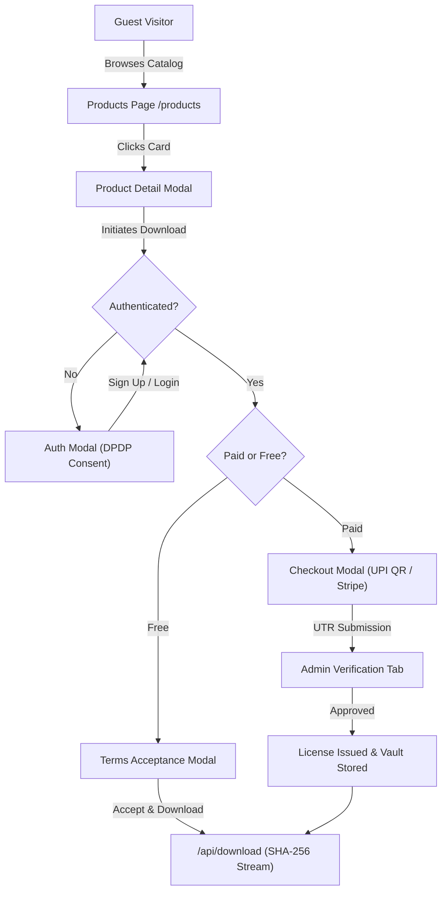

# Upper Store - Comprehensive Technical Architecture & Complete Application Flows

This document provides the master technical specification, complete route and page blueprints, interactive overlay specifications, end-to-end user journeys, and operational workflows across the entire Upper Store platform.

---

## 1. Executive Architectural Overview

Upper Store is a zero-trust software distribution platform, digital asset marketplace, and developer publishing ecosystem designed for maximum information density, strict cryptographic integrity, and statutory legal compliance.

### 1.1. Core Technology Stack
- **Frontend Core**: React 18, React Router v6, Vite 8, Pure CSS3 Design System with Hardware-Accelerated Transforms and Variables.
- **3D Graphics & Physics Engine**: Three.js WebGL (Interactive 3D Crimson Crystalline Neural Core, orbiting particle halos, ambient lighting physics, dynamic drag interactions).
- **Backend Core**: Node.js, Express.js (Cluster Mode multi-core scaling, Helmet security headers, compression, trust-proxy rate limiters).
- **Primary Database**: Google Firebase Cloud Firestore (NoSQL document store with ACID transaction support, atomic batch operations, and real-time listeners).
- **Authentication**: Firebase Authentication (Email/Password, OAuth providers) paired with custom JWT session tokens (`adminToken`, user bearer tokens).
- **Asset Storage & CDN**: ImageKit CDN (Raster media, developer banners, application logos, responsive transformations), GitHub Release APIs (High-speed verified binary payloads).
- **Edge Layer**: Cloudflare Workers (Edge caching, header enforcement, bot defense, rate limiting, SSL termination).
- **Statutory Compliance**: Full compliance with the India Digital Personal Data Protection (DPDP) Act 2023 (Explicit consent checkboxes, right to access, right to erasure, cascade deletion).

---

## 2. Complete Frontend Pages Directory

Upper Store features 16 primary route pages managed by React Router v6 in [App.jsx](file:///c:/Users/jiten/OneDrive/Desktop/MY%20FOLDERS/PROJECTS/My%20site/frontend/src/App.jsx).

| Route Path | Page Component | Primary Source File | Access Guard | Functional Scope |
| :--- | :--- | :--- | :--- | :--- |
| `/` | `Home` | [Home.jsx](file:///c:/Users/jiten/OneDrive/Desktop/MY%20FOLDERS/PROJECTS/My%20site/frontend/src/pages/Home.jsx) | Public | Storefront landing page, 3D crystalline core, featured software, global CDN telemetry, and VIP showcase banner. |
| `/products` | `Products` | [Products.jsx](file:///c:/Users/jiten/OneDrive/Desktop/MY%20FOLDERS/PROJECTS/My%20site/frontend/src/pages/Products.jsx) | Public | Software catalog, category filtering, search query filtering, sorting, pagination, and product video demos tab. |
| `/products/:id` | `ProductDetail` | [ProductDetail.jsx](file:///c:/Users/jiten/OneDrive/Desktop/MY%20FOLDERS/PROJECTS/My%20site/frontend/src/pages/ProductDetail.jsx) | Public | Deep-linked standalone product page mounting the comprehensive product inspection suite. |
| `/developer-studio` `/studio` `/developer/studio` `/dev/studio` | `DeveloperStudio` | [DeveloperStudio.jsx](file:///c:/Users/jiten/OneDrive/Desktop/MY%20FOLDERS/PROJECTS/My%20site/frontend/src/pages/DeveloperStudio.jsx) | VIP Member | Full-page publishing suite: pre-flight malware scanner, package upload, catalog management, broadcasts, and statutory KYC. |
| `/vip` `/vip-club` | `VipClub` | [VipClub.jsx](file:///c:/Users/jiten/OneDrive/Desktop/MY%20FOLDERS/PROJECTS/My%20site/frontend/src/pages/VipClub.jsx) | Public / Auth | VIP membership hub: Pro VIP vs Elite VIP tiers, animated border previews, handle reservation, and Razorpay / UPI checkout. |
| `/developer/:username` `/developers/:username` `/dev/:username` | `DeveloperProfile` | [DeveloperProfile.jsx](file:///c:/Users/jiten/OneDrive/Desktop/MY%20FOLDERS/PROJECTS/My%20site/frontend/src/pages/DeveloperProfile.jsx) | Public / Owner | Dynamic developer showcase: cover photo with 2D focal positioning, avatar with glowing aura, bio, social handles, followers counter, and published catalog. |
| `/about` | `About` | [About.jsx](file:///c:/Users/jiten/OneDrive/Desktop/MY%20FOLDERS/PROJECTS/My%20site/frontend/src/pages/About.jsx) | Public | Platform mission, zero-trust cryptographic verification architecture, SHA-256 validation policy, and engineering leadership. |
| `/contact` | `Contact` | [Contact.jsx](file:///c:/Users/jiten/OneDrive/Desktop/MY%20FOLDERS/PROJECTS/My%20site/frontend/src/pages/Contact.jsx) | Public | Customer support and grievance portal dispatching inquiries directly to encrypted Firestore for guaranteed delivery. |
| `/faq` | `Faq` | [Faq.jsx](file:///c:/Users/jiten/OneDrive/Desktop/MY%20FOLDERS/PROJECTS/My%20site/frontend/src/pages/Faq.jsx) | Public | Interactive animated accordion help center covering installations, APK sideloading, VIP membership billing, and security. |
| `/blog` | `Blog` | [Blog.jsx](file:///c:/Users/jiten/OneDrive/Desktop/MY%20FOLDERS/PROJECTS/My%20site/frontend/src/pages/Blog.jsx) | Public | Engineering articles, software releases, security changelogs, and full-text reading modal overlay. |
| `/press` | `Press` | [Press.jsx](file:///c:/Users/jiten/OneDrive/Desktop/MY%20FOLDERS/PROJECTS/My%20site/frontend/src/pages/Press.jsx) | Public | Official brand assets, high-res logo packages, brand color palette hex tokens, typography guidelines, and media contact info. |
| `/policies` | `Policies` | [Policies.jsx](file:///c:/Users/jiten/OneDrive/Desktop/MY%20FOLDERS/PROJECTS/My%20site/frontend/src/pages/Policies.jsx) | Public | Multi-anchor compliance document: Store Policies, Terms of Service, Code of Conduct, DPDP Privacy Policy, and Grievance Officer details. |
| `/admin` | `AdminLogin` | [AdminLogin.jsx](file:///c:/Users/jiten/OneDrive/Desktop/MY%20FOLDERS/PROJECTS/My%20site/frontend/src/pages/AdminLogin.jsx) | Public / Admin | Administrative authentication gate verifying admin credentials against backend JWT endpoints. |
| `/admin/dashboard` | `AdminDashboard` | [AdminDashboard.jsx](file:///c:/Users/jiten/OneDrive/Desktop/MY%20FOLDERS/PROJECTS/My%20site/frontend/src/pages/AdminDashboard.jsx) | Admin Session | Full administrative control suite containing 10 operational management panels, real-time telemetry, and moderation tools. |
| `/404`, `*` | `NotFound` | [NotFound.jsx](file:///c:/Users/jiten/OneDrive/Desktop/MY%20FOLDERS/PROJECTS/My%20site/frontend/src/pages/NotFound.jsx) | Public | Error page featuring the minimalist rotating 3D crimson crystal orb, heading, and return to home button. |
| `/403`, `/forbidden` | `Forbidden` | [Forbidden.jsx](file:///c:/Users/jiten/OneDrive/Desktop/MY%20FOLDERS/PROJECTS/My%20site/frontend/src/pages/Forbidden.jsx) | Public | Access denied page featuring the minimalist rotating 3D crimson crystal orb, heading, and return to home button. |

---

## 3. Popups, Modals, Drawers & Overlays Inventory

The platform integrates 26 dedicated modals, slide-out drawers, and dropdown overlays rendered into `document.body` via React portals:

1. **Authentication Modal (`AuthModal.jsx`)**: Tabbed login/signup with statutory DPDP consent checkboxes, 18+ age verification, and password visibility toggles.
2. **Global Omnibar Search Modal (`GlobalSearchModal.jsx`)**: Triggered via `Ctrl+K`, search icon, or mobile drawer; real-time debounced query search across software titles, tags, and developer handles.
3. **Product Detail Quick View Modal (`ProductDetailModal.jsx`)**: Complete technical showcase, screenshots carousel, permissions, SHA-256 checksums, and download triggers.
4. **Product Permissions Modal (`ProductPermissionsModal.jsx`)**: Manifest permission inspector for Android APK and Windows executables with risk-tier badges.
5. **Product Reviews & Ratings Modal (`ProductReviewsModal.jsx`)**: Average score, rating breakdown, verified review submission form, and author review deletion.
6. **Terms Acceptance Modal (`TermsAcceptanceModal.jsx`)**: Pre-download software distribution agreement required before direct binary streaming begins.
7. **Checkout & License Modal (`CheckoutModal.jsx`)**: Multi-step payment processing: Dynamic UPI QR code, UPI intent links, manual UTR verification, Stripe, and license key generation.
8. **VIP Club Upgrade Modal (`VipClubModal.jsx`)**: Tier comparison (Pro VIP vs Elite VIP) and instant subscription activation.
9. **Cancel VIP Subscription Modal (`CancelSubscriptionModal.jsx`)**: Churn prevention benefits summary, expiry date review, and cancellation confirmation.
10. **Claim VIP Username Modal (`VipUsernameModal.jsx`)**: Exclusive handle reservation for active VIP members with live database availability checks.
11. **Developer Studio Modal (`DeveloperStudioModal.jsx`)**: In-page modal version of the developer publishing suite.
12. **Edit Profile Modal (`EditProfileModal.jsx`)**: Avatar and banner image uploaders via ImageKit CDN, interactive 2D drag repositioner, bio, and social handles.
13. **Developer Followers / Following Modal (`DeveloperFollowModal.jsx`)**: Tabbed list of community audience with instant follow/unfollow buttons.
14. **Developer Private Download Telemetry Modal (`DeveloperDownloadsModal.jsx`)**: Private analytics and product download trends visible strictly to the developer owner.
15. **User Download History Modal (`DownloadHistoryModal.jsx`)**: Chronological archive of all packages downloaded by the user with re-download actions.
16. **User Software Licenses Modal (`UserLicensesModal.jsx`)**: Vault of purchased license keys with copy-to-clipboard functionality.
17. **Notification Center Popover (in `Navbar.jsx`)**: Real-time notification feed for follower alerts, product updates, and platform broadcasts.
18. **User Profile Dropdown Menu (in `Navbar.jsx`)**: Compact dropdown providing shortcuts to developer studio, downloads, licenses, VIP handle claims, and account settings.
19. **Mobile Navigation Hamburger Drawer (in `Navbar.jsx`)**: Fullscreen slide-over drawer on viewports `<= 768px` for store navigation.
20. **Mobile Settings Side Panel (`AccountSettingsModal.jsx`)**: Dedicated slide-out drawer on mobile devices housing user settings, password updates, and sign-out buttons.
21. **Mobile Category Filter Drawer (in `Products.jsx`)**: Collapsible mobile category selector on the Products page.
22. **Blog Article Reader Modal (in `Blog.jsx`)**: Full-width reading overlay for engineering articles and release changelogs.
23. **Security Advisories Modal (in `Footer.jsx`)**: Detailed security disclosures on SHA-256 checks, CDN delivery, and Firestore delivery guarantees.
24. **System Status Monitor Modal (in `Footer.jsx`)**: Real-time status indicators for API Gateway, Edge CDN, Firestore Database, and Auth Service.
25. **Admin User Activity Detail Modal (in `AdminDashboard.jsx`)**: Comprehensive admin inspection of user telemetry, downloads, payments, and ban controls.
26. **Admin Reject Payment Reason Modal (in `AdminDashboard.jsx`)**: Explanatory rejection note modal when declining manual UPI payment submissions.

---

## 4. End-to-End Application Flows

This section maps out every complete operational flow across all pages, detailing triggers, state transitions, backend endpoints, and UI responses.

---

### Flow 1: Guest Discovery & Storefront Browsing
1. **User Entry**: User visits the root path `/` ([Home.jsx](file:///c:/Users/jiten/OneDrive/Desktop/MY%20FOLDERS/PROJECTS/My%20site/frontend/src/pages/Home.jsx)).
2. **3D Crystalline Core Initialization**:
   - `CrystalCore3D.jsx` mounts inside the hero container.
   - Three.js sets up a WebGLRenderer, creates the faceted crystal geometry with crimson wireframe cage and 1,000 orbiting particle points.
   - User drags the crystal: rotation momentum and spring physics calculate inertia without blocking UI thread.
3. **Featured Software Browsing**:
   - `Home.jsx` fetches active products from `GET /api/products?limit=8`.
   - Products render with software title, rating stars, developer handle (`@username`), and price tag.
4. **Global Search Activation**:
   - User presses `Ctrl+K` / `Cmd+K` or taps search button on navbar.
   - `GlobalSearchModal` opens; user types query.
   - Frontend debounces query (300ms) and calls `GET /api/search?q={query}`.
   - Results list matching applications and developer profiles with keyboard arrow selection.
5. **Full Catalog Navigation**:
   - User clicks "All Products" -> navigates to `/products` ([Products.jsx](file:///c:/Users/jiten/OneDrive/Desktop/MY%20FOLDERS/PROJECTS/My%20site/frontend/src/pages/Products.jsx)).
   - User selects category (e.g., "Developer Utilities" or "Games").
   - Responsive grid updates dynamically with pagination controls.

---

### Flow 2: User Onboarding, Authentication & DPDP Compliance
1. **Trigger**: User clicks "Sign In" on header or initiates a gated action.
2. **Modal Presentation**:
   - `AuthModal.jsx` mounts into body.
   - Defaults to "Sign In" tab; user can toggle to "Create Account".
3. **Registration & Statutory Data Protection Consent**:
   - User enters Full Name, unique username handle, Email, and Password.
   - Username handle is validated in real time via `GET /api/auth/username-status?username={handle}` (alphanumeric, lowercase, no system keywords).
   - Mandatory Checkbox 1: Age verification (18+ years of age).
   - Mandatory Checkbox 2: Statutory consent under India DPDP Act 2023 for data processing.
   - User can expand the collapsible Privacy Notice drawer to review data retention, rights to erasure, and grievance redressal officer details.
4. **Backend Processing**:
   - Frontend sends `POST /api/auth/register` with consent timestamp, IP record, and credentials.
   - Backend hashes password with bcrypt (salt rounds: 10), initializes user record in Firestore `users` collection with `role: "user"`, `isVip: false`, and statutory DPDP consent metadata.
   - Issues signed JWT token.
5. **State Synchronization**:
   - `AuthContext.jsx` saves token to localStorage and sets `user` state.
   - Header instantly replaces "Sign In" button with user avatar and VIP badge.

---

### Flow 3: Software Download & SHA-256 Verification
1. **Trigger**: User clicks "Download" or "Details" on any product card.
2. **Product Details Inspection**:
   - `ProductDetailModal.jsx` opens with full screenshots, specs, file size, OS architecture, and SHA-256 checksum string.
3. **Pre-Download Eligibility**:
   - System checks if product is free or paid.
   - System checks if platform fee applies to non-VIP members (`GET /api/settings/platform-fee`).
4. **Terms Acceptance**:
   - `TermsAcceptanceModal.jsx` presents software distribution terms, safety advisories, and disclaimer.
   - User clicks "Accept & Download".
5. **Binary Delivery & Cryptographic Verification**:
   - Frontend triggers download via `GET /api/download?id={productId}&file={filename}` or direct GitHub Release endpoint.
   - Backend streams binary with `Content-Disposition: attachment` and custom header `X-Checksum-SHA256`.
   - Download event is recorded in Firestore `downloads` collection via `POST /api/downloads/record` (rate-limited by IP to prevent spoofing).
   - Record is added to the user's `DownloadHistoryModal`.

---

### Flow 4: Paid Software Monetization, Licensing & Payment
1. **Trigger**: User clicks "Buy License" or "Pay Fee" on a paid product.
2. **Checkout Modal Execution**:
   - `CheckoutModal.jsx` opens.
3. **Payment Method Selection**:
   - **Method A: Real UPI QR Code**:
     - System displays official merchant UPI QR code and clickable UPI Intent links (GPay, PhonePe, Paytm).
     - User completes payment on mobile and enters 12-digit UPI UTR transaction reference number into the verification box.
     - Frontend submits `POST /api/payments/submit-upi-payment`.
     - Payment record created in Firestore `payments` collection with status `"pending"`.
   - **Method B: Stripe Gateway**:
     - Frontend calls `POST /api/payments/create-checkout-session`.
     - User completes card transaction on Stripe checkout; Stripe webhook `POST /api/payments/webhook/stripe` verifies signature and updates record.
4. **Admin Approval (For Manual UPI)**:
   - Admin opens Admin Dashboard -> "Payment Verification" tab.
   - Reviews UTR reference, amount, and user email.
   - Clicks "Approve": Backend triggers `licenseService.js`, generates a unique cryptographic license key (`UPPER-XXXX-XXXX-XXXX`), and updates status to `"approved"`.
5. **License Vault Delivery**:
   - User receives real-time notification in header.
   - User opens "My Licenses" modal (`UserLicensesModal.jsx`): license key is displayed with copy button and immediate download authorization.

---

### Flow 5: VIP Club Membership & Exclusive Handle Reservation
1. **Trigger**: User navigates to `/vip` or clicks VIP banner.
2. **Tier Comparison**:
   - User reviews Pro VIP (Gold Crown, glowing yellow/white ring) vs Elite VIP (Crimson Diamond, glowing crimson/white ring).
3. **Subscription Activation**:
   - User initiates subscription via Razorpay / Stripe gateway.
   - Backend webhook `POST /api/payments/webhook/razorpay` verifies HMAC signature, updates `users/{uid}` with `isVip: true`, `vipPlan: "elite"`, and expiry timestamp.
4. **VIP Handle Claim**:
   - Active VIP member opens `VipUsernameModal.jsx` from navbar menu.
   - Enters desired custom handle (e.g., `@cryptoking`).
   - Frontend calls `PUT /api/auth/username`; backend checks uniqueness, locks reservation, and assigns vanity profile URL `/developer/cryptoking`.
5. **Visual Aura Upgrades**:
   - `VipAvatar.jsx` renders animated rotating conic gradient border and breathing ambient glow across all site appearances.
   - Developer Studio publishing privileges unlocked.

---

### Flow 6: Developer Studio Publishing & Security Audit
1. **Trigger**: VIP member navigates to `/developer-studio` or opens `DeveloperStudioModal.jsx`.
2. **Statutory KYC & Developer Agreement**:
   - First-time publishers complete DPDP developer compliance agreement.
3. **Application Package Upload**:
   - Developer enters title, description, category, version, and pricing.
   - Selects application package binary (.apk, .exe, .zip).
   - Selects application icon and product screenshots.
4. **Pre-Flight Static Security Analysis**:
   - Client-side preflight scanner (`preflightScanner.js`) reads binary buffer via Web Workers.
   - Calculates cryptographic SHA-256 checksum locally.
   - Inspects package manifest: extracts required Android permissions or Windows subsystem hooks.
5. **Backend Processing & Catalog Insertion**:
   - Frontend streams package to `POST /api/products` using chunked multipart upload.
   - Backend `securityScanService.js` performs second-pass binary audit, confirms SHA-256 checksum matches, scans for malicious signatures, and pushes media assets to ImageKit CDN.
   - Product record created in Firestore `products` collection with status `"pending"`.
6. **Admin Moderation & Approval**:
   - Admin reviews submission in Admin Dashboard -> "Products" tab.
   - Admin verifies security report and clicks "Approve".
   - Product status updates to `"approved"` and appears publicly in `/products` catalog.
   - System triggers follower broadcast push notification to all users following this developer.

---

### Flow 7: Developer Profile, Community Follow & Cascade Deletion
1. **Profile Navigation**:
   - User visits `/developer/:username` ([DeveloperProfile.jsx](file:///c:/Users/jiten/OneDrive/Desktop/MY%20FOLDERS/PROJECTS/My%20site/frontend/src/pages/DeveloperProfile.jsx)).
2. **Profile Data Aggregation**:
   - Frontend calls `GET /api/developers/:username`.
   - Backend aggregates developer bio, website, GitHub, Twitter, avatar, cover photo URL, and cover vertical drag focal position (`objectPosition`).
   - Fetches developer's published software catalog and active follower/following counts.
3. **Follow / Unfollow Action**:
   - User clicks "Follow".
   - Frontend applies optimistic UI update (+1 counter, active button state).
   - Sends `POST /api/developers/:username/follow`.
   - Backend records follow document in `follows` collection and dispatches notification to developer.
4. **Audience Modal Inspection**:
   - User clicks "Followers" or "Following" pill -> opens `DeveloperFollowModal.jsx`.
   - Displays real-time user list with VIP status rings and direct follow buttons.
5. **Profile Editing (Owner Only)**:
   - Developer owner clicks "Edit Profile" -> opens `EditProfileModal.jsx`.
   - Uploads new cover banner; adjusts vertical position slider to set focal alignment.
   - Saves changes via `PUT /api/auth/profile`.
6. **Account Erasure Cascade Safety**:
   - If a user deletes their account or an admin deletes a profile, the backend cascade cleanup service automatically queries and deletes all orphaned follow documents (`followerId` or `followingId`) and removes orphaned notification records.

---

### Flow 8: Administrative Governance & Control Suite
1. **Authentication Gate**:
   - Admin navigates to `/admin` ([AdminLogin.jsx](file:///c:/Users/jiten/OneDrive/Desktop/MY%20FOLDERS/PROJECTS/My%20site/frontend/src/pages/AdminLogin.jsx)).
   - Submits admin credentials to `POST /api/auth/admin-login`.
   - Backend verifies admin hash, generates `adminToken`, and sets session.
2. **Dashboard Management Panels (`AdminDashboard.jsx`)**:
   - **Tab 1: Products Management**: Edit metadata, update SHA-256 checksums, toggle public approval status, delete software.
   - **Tab 2: Developers & KYC**: Inspect submitted developer documentation, approve publisher permissions, or suspend bad actors.
   - **Tab 3: User Directory**: Full user search, standard vs VIP filters, open `Admin User Activity Detail Modal`, ban/unban users, delete accounts.
   - **Tab 4: Grievance & Appeals**: Review account restriction appeals and resolve user grievances.
   - **Tab 5: Customer Inquiries**: Real-time Firestore inbox receiving messages from `/contact`. Mark read, reply via email, or delete.
   - **Tab 6: Global Notifications**: Compose and broadcast system alerts to all users, active developers, or VIP subscribers.
   - **Tab 7: Platform Fee Config**: Adjust store commission rates and developer download fee thresholds.
   - **Tab 8: Payment Verification**: Review submitted manual UPI UTRs; approve to auto-issue license keys or reject with explanatory note.
   - **Tab 9: Official Store Profile**: Update Upper Store publisher profile, upload official background cover banner to ImageKit, and adjust 2D drag vertical focal point with live desktop and mobile preview frames.
   - **Tab 10: Download Telemetry**: Live download event stream, IP addresses, user agents, and catalog popularity rankings.

---

### Flow 9: Customer Support Ingestion & Direct Firestore Bypass
1. **User Inquiry**: User fills out support form on `/contact` ([Contact.jsx](file:///c:/Users/jiten/OneDrive/Desktop/MY%20FOLDERS/PROJECTS/My%20site/frontend/src/pages/Contact.jsx)).
2. **Direct Delivery Architecture**:
   - Inquiries bypass cloud SMTP mailer servers (which often suffer cloud provider port 25/587 throttling or spam drops).
   - Form sends `POST /api/contact` directly into encrypted Firestore `inbox` collection.
3. **Admin Alerting**:
   - Admin Dashboard top navigation displays live unread counter badge.
   - Admin reviews inquiry and initiates direct customer reply.

---

### Flow 10: India DPDP Act 2023 Statutory Compliance & Account Erasure
1. **Statutory Principles Enforced**:
   - Explicit consent at signup with unambiguous purpose specification.
   - Right to Access: User can inspect all personal data, licenses, and downloads via account modals.
   - Right to Correction: User can update personal identifiers via `EditProfileModal.jsx`.
   - Right to Erasure / Consent Withdrawal: User can request permanent data erasure via account settings.
2. **Account Deletion Cascade**:
   - User or Admin initiates account deletion via `DELETE /api/auth/account`.
   - Backend atomic transaction executes:
     - Deletes user record from `users` collection.
     - Deletes user auth credentials in Firebase Auth.
     - Removes user reviews from `reviews` collection.
     - Deletes follow records in `follows` collection (both as follower and following).
     - Deletes private notifications in `notifications` collection.
     - Deletes active software licenses and download logs.
     - Invalidates active JWT tokens immediately.

---

### Flow 11: Resilience, Quota Exhaustion & Error Recovery
1. **Firestore Quota Interception**:
   - Backend `server.js` monitors Firestore API error responses (`isFirestoreQuotaError`).
   - If quota is exceeded, the server automatically returns `503 Service Unavailable` with `Retry-After: 60` and JSON `{ status: "maintenance", maintenance: true, code: "QUOTA_EXCEEDED" }`.
2. **Frontend Graceful Degradation**:
   - `App.jsx` listens for `503` responses or `upperMaintenanceMode` custom window event.
   - Page view immediately swaps to [MaintenanceBreak.jsx](file:///c:/Users/jiten/OneDrive/Desktop/MY%20FOLDERS/PROJECTS/My%20site/frontend/src/components/MaintenanceBreak.jsx).
   - Minimalist 3D crystal core renders in low-overhead mode; automated retry timer polls `GET /api/health` every 30 seconds.
   - As soon as the backend responds `healthy`, `MaintenanceBreak` clears and seamlessly restores the active page state.
3. **404 & 403 Minimalist Handling**:
   - Catch-all routes render `NotFound.jsx` or `Forbidden.jsx`.
   - Both pages display the rotating 3D crimson crystal orb with minimalist typography, suppressing the heavy footer to maintain pure aesthetic focus.

---

## 5. Backend REST API Endpoints Directory

| Category | Method | Endpoint Path | Access Level | Description |
| :--- | :--- | :--- | :--- | :--- |
| **Auth** | `POST` | `/api/auth/register` | Public | Register new user account with statutory DPDP consent. |
| **Auth** | `POST` | `/api/auth/login` | Public | Authenticate user credentials and issue session JWT. |
| **Auth** | `POST` | `/api/auth/admin-login` | Public | Authenticate administrator credentials for dashboard access. |
| **Auth** | `GET` | `/api/auth/users` | Admin | Retrieve complete user directory with pagination and filters. |
| **Auth** | `PUT` | `/api/auth/ban/:uid` | Admin | Toggle user suspension or account ban. |
| **Auth** | `DELETE` | `/api/auth/user/:uid` | Admin | Permanently delete user account and execute cascade cleanup. |
| **Auth** | `PUT` | `/api/auth/profile` | Auth User | Update display name, bio, social links, and cover focal point. |
| **Auth** | `POST` | `/api/auth/cover` | Auth User | Upload profile background cover banner image to ImageKit. |
| **Auth** | `DELETE` | `/api/auth/account` | Auth User | User self-service DPDP consent withdrawal and account deletion. |
| **Products** | `GET` | `/api/products` | Public | Fetch catalog software with category filtering, search, and sort. |
| **Products** | `GET` | `/api/products/:id` | Public | Retrieve detailed specifications and checksums for single product. |
| **Products** | `POST` | `/api/products` | Publisher | Upload new software package (.apk, .exe, .zip) with media. |
| **Products** | `PUT` | `/api/products/:id` | Admin / Owner | Update software metadata, versioning, or SHA-256 checksums. |
| **Products** | `DELETE` | `/api/products/:id` | Admin / Owner | Permanently remove product from catalog and delete storage assets. |
| **Downloads** | `GET` | `/api/download` | Public / Gated | Stream binary payload with verification headers (`proxyDownload`). |
| **Downloads** | `POST` | `/api/downloads/record` | Public | Rate-limited download event recorder. |
| **Downloads** | `GET` | `/api/downloads/history/:email`| Auth User | Retrieve user's personal download history records. |
| **Downloads** | `DELETE`| `/api/downloads/history/:email`| Auth User | Clear user's personal download history records. |
| **Downloads** | `GET` | `/api/downloads/admin/all` | Admin | View live global download telemetry logs across all products. |
| **Payments** | `POST` | `/api/payments/create-checkout-session` | Auth User | Initialize Stripe checkout session for paid software licenses. |
| **Payments** | `POST` | `/api/payments/verify-razorpay` | Auth User | Verify Razorpay payment signature for VIP membership. |
| **Payments** | `POST` | `/api/payments/submit-upi-payment` | Auth User | Submit manual UPI UTR transaction reference for review. |
| **Payments** | `GET` | `/api/payments/my-upi-payments` | Auth User | Fetch user's pending and approved UPI transactions. |
| **Payments** | `GET` | `/api/payments/admin/upi-payments` | Admin | Fetch all pending manual UPI payments for verification. |
| **Payments** | `POST` | `/api/payments/admin/verify-upi-payment` | Admin | Approve or reject manual UPI payment and issue license key. |
| **Developers**| `GET` | `/api/developers/:username` | Public | Retrieve public developer profile, catalog, and stats. |
| **Developers**| `POST` | `/api/developers/:username/follow` | Auth User | Follow or unfollow a developer with duplicate suppression. |
| **Developers**| `GET` | `/api/developers/:username/followers` | Public | Retrieve list of users following this developer. |
| **Developers**| `GET` | `/api/developers/:username/following` | Public | Retrieve list of developers followed by this user. |
| **Reviews** | `GET` | `/api/reviews/product/:productId` | Public | Retrieve verified customer ratings and reviews for a product. |
| **Reviews** | `POST` | `/api/reviews/product/:productId` | Auth User | Submit or update star rating and written review. |
| **Reviews** | `DELETE`| `/api/reviews/:reviewId` | Auth / Admin | Delete review entry and recompute product rating average. |
| **Search** | `GET` | `/api/search` | Public | Omnibar search query filtering software and developers. |
| **Contact** | `POST` | `/api/contact` | Public | Submit customer inquiry directly to Firestore `inbox`. |
| **Contact** | `GET` | `/api/contact` | Admin | Fetch customer inquiries in admin inbox. |
| **Settings** | `GET` | `/api/settings/platform-fee` | Public | Fetch current platform commission percentage. |
| **Settings** | `PUT` | `/api/settings/platform-fee` | Admin | Update platform commission settings. |
| **Health** | `GET` | `/api/health` | Public | Telemetry, memory usage, uptime, cluster status, and cache metrics. |

---

## 6. Firestore Database Architecture

The application relies on 10 core Firestore collections:

1. **`users` Collection**:
   - `uid`, `email`, `username`, `displayName`, `role` (`"user"` | `"admin"`), `isVip`, `vipPlan` (`"pro"` | `"elite"`), `validUntil`, `avatar`, `coverUrl`, `coverFocalPosition`, `bio`, `website`, `github`, `twitter`, `instagram`, `dpdpConsent` (`consentedAt`, `ipRecord`, `version`), `createdAt`, `lastLoginAt`.
2. **`products` Collection**:
   - `id`, `title`, `description`, `category`, `price`, `version`, `architecture`, `fileSize`, `apkFile`, `iconUrl`, `screenshots`, `averageRating`, `reviewsCount`, `downloadsCount`, `developerId`, `developerUsername`, `developerAvatar`, `sha256Checksum`, `permissions`, `isStoreOfficial`, `status` (`"approved"` | `"pending"` | `"rejected"`).
3. **`reviews` Collection**:
   - `id`, `productId`, `userId`, `userEmail`, `username`, `userAvatar`, `rating` (1-5), `title`, `review`, `createdAt`.
4. **`payments` Collection**:
   - `id`, `userId`, `userEmail`, `productId`, `amount`, `currency`, `method` (`"upi"` | `"stripe"` | `"razorpay"`), `utrNumber`, `status` (`"pending"` | `"approved"` | `"rejected"`), `licenseKey`, `rejectionReason`, `createdAt`, `updatedAt`.
5. **`licenses` Collection**:
   - `id`, `licenseKey`, `productId`, `userId`, `userEmail`, `orderId`, `status` (`"active"` | `"revoked"`), `issuedAt`.
6. **`follows` Collection**:
   - `id`, `followerId`, `followerUsername`, `followingId`, `followingUsername`, `createdAt`.
7. **`notifications` Collection**:
   - `id`, `recipientId`, `senderId`, `type` (`"follow"` | `"release"` | `"system"`), `title`, `message`, `link`, `isRead`, `createdAt`.
8. **`inbox` Collection**:
   - `id`, `fullName`, `email`, `category`, `message`, `status` (`"unread"` | `"read"` | `"resolved"`), `submittedAt`.
9. **`appeals` Collection**:
   - `id`, `userId`, `email`, `reason`, `status` (`"pending"` | `"resolved"` | `"rejected"`), `createdAt`.
10. **`settings` Collection**:
    - Platform-wide configurations: `platformFeePercent`, `minPayoutThreshold`, `officialCoverFocalPosition`, `paymentGatewayKeys`.

---

## 7. Performance, Caching & Zero-Trust Security Guarantees

1. **Zero Emojis Policy**: Standardized, clean corporate and engineering aesthetics across all source code, system logs, interfaces, and documentation.
2. **Cluster Multi-Core Concurrency**: Production backend automatically detects CPU cores and forks worker processes to handle high-volume concurrent traffic.
3. **In-Memory & Edge Caching**:
   - High-read endpoints (catalog, search, developer profiles) utilize TTL-based in-memory caching and Cloudflare Edge Worker caching.
   - Mutating routes explicitly emit `Cache-Control: no-store` to prevent stale cache contamination.
4. **Cryptographic Checksum Enforcement**:
   - Every binary payload is validated with client-side and server-side SHA-256 cryptographic hashing.
5. **Fail-Safe Quota Resilience**:
   - Server-level quota guard intercepts database exhaustion and converts internal errors to `503 Service Unavailable`, prompting the frontend to transition cleanly to the `MaintenanceBreak` recovery state.
